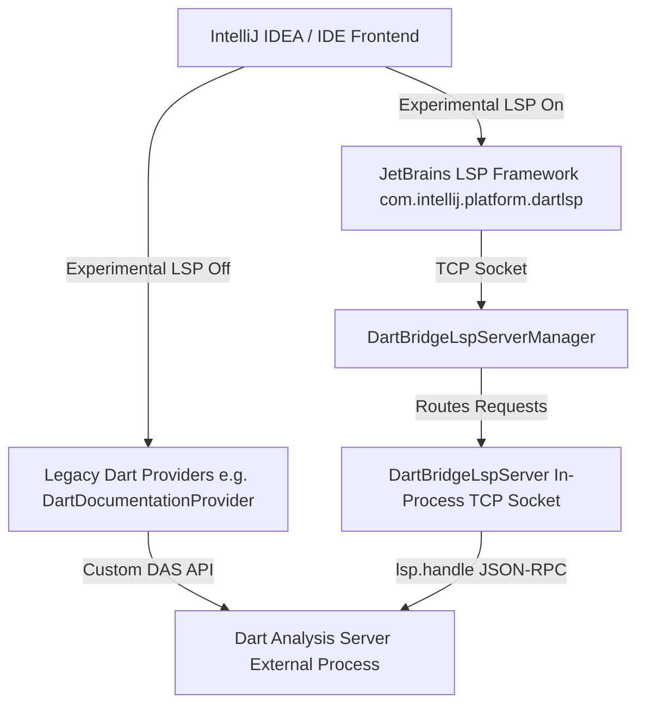

# Migrating Dart Analysis Server Features to JetBrains LSP

This skill provides comprehensive architectural context, guidelines, and step-by-step instructions for converting legacy Dart Analysis Server (DAS) features (such as hover, navigation, diagnostics, code completion, etc.) over to the JetBrains LSP integration.

---

## 1. High-Level Architecture

The Dart IntelliJ plugin operates under a hybrid architecture during the transition from custom DAS protocols to the Language Server Protocol (LSP):



### The Bridge Server Architecture
JetBrains' native LSP client expects to connect to a socket or standard I/O stream speaking JSON-RPC 2.0. Because the Dart Analysis Server (DAS) is already running as a standalone process managed by `DartAnalysisServerService`, we do not launch a second LSP server process.
Instead, `DartBridgeLspServerManager` hosts a lightweight in-process TCP socket bridge (`DartBridgeLspServer`). When the JetBrains LSP framework sends an LSP request (e.g., `textDocument/hover`), `DartBridgeLspServer` wraps the LSP payload into a custom DAS request named `lsp.handle` (`{ "lspMessage": <jsonrpc payload> }`), forwards it to DAS, and unpacks the returned `lspResponse` back to the JetBrains LSP framework.

### Designing for "Full LSP" (Decoupling from `DartAnalysisServerService`)
`DartAnalysisServerService`, `DartServerData`, and `DartBridgeLspServer` are **transitional** components that will be deleted when the plugin switches from LSP-over-legacy to Full LSP. Keep new LSP code decoupled from legacy infrastructure so it does not have to be rewritten later:
1. **Keep LSP Services & UI Providers Pure**: New LSP features, state services (e.g., `DartLspClosingLabelsService`), and UI providers must **not** import or call `DartAnalysisServerService`, `DartServerData`, or `DartBridgeLspServer`.
2. **Use LSP Descriptor URI Mapping**: When converting between `VirtualFile` and file URIs in LSP code, use `server.descriptor.getFileUri(file)` and `server.descriptor.findFileByUri(uri)` instead of legacy `getDartFileInfo(...)`.
3. **Route Server Notifications Through `Lsp4jClient`**: Handle server-pushed LSP notifications (such as `textDocument/publishDiagnostics` or custom notifications like `dart/textDocument/publishClosingLabels`) in `DartLsp4jClient` (inside [DartLspServerDescriptor.kt](../../../third_party/src/main/java/com/jetbrains/lang/dart/lsp/DartLspServerDescriptor.kt)) and push updates into standalone LSP services.
4. **Place Backward-Compatibility Adapters at the Legacy Boundary**: When an LSP notification is only emitted by newer Dart SDKs and older SDKs still emit a legacy DAS notification, keep the UI provider reading exclusively from the new LSP service. In `DartAnalysisServerService`, convert the legacy payload and push it into the LSP service when the LSP feature is not active for that SDK. When `DartAnalysisServerService` is eventually deleted in Full LSP mode, the legacy adapter disappears with it without touching the UI or LSP service.

---

## 2. Critical Nuances & Guidelines

> [!IMPORTANT]
> **Copied JetBrains LSP Client Sources (`com.intellij.platform.dartlsp`)**
> To support IntelliJ Platform versions 2025.3 and 2026.1 before JetBrains' official Ultimate LSP client becomes open source in Community Edition, the platform LSP framework was copied into `third_party/thirdPartySrc/platform-lsp/` under the namespace `com.intellij.platform.dartlsp`.

### Copied Platform Code & Upstream YouTrack (`IJPL-...`) Workflow
When working with or modifying LSP features, adhere to these rules regarding copied platform code:
1. **Check `intellij-community` and YouTrack (`IJPL`) First**: Before writing custom PSI/LSP workarounds or Dart-specific UI wrappers for a missing feature or bug, check whether:
   - `intellij-community` already has an uncopied `platform/lsp-impl` module (for example, `platform/lsp-impl/structureView` for Structure View), or
   - The bug has already been reported and fixed upstream on JetBrains YouTrack (`IJPL-...`), allowing you to backport the upstream commit via [patch.py](../patch-copied-lsp-sources/scripts/patch.py) (for example, `IJPL-156979` for *Go to Declaration or Usages*) instead of adding custom PSI glue.
2. **Avoid Major Structural Changes**: Do not make arbitrary or major structural refactorings inside `third_party/thirdPartySrc/platform-lsp/`. We anticipate dropping this directory entirely and migrating to JetBrains' official open-source platform code in the future.
3. **Automate Necessary Patches**: If a modification to the copied platform code is strictly required (for example, removing the `ProjectFileIndex.isInContent` check in `LspServerImpl.kt` so external library files in `.pub-cache` or `dart:io` receive LSP hovers), you **must** codify the fix inside [patch.py](../patch-copied-lsp-sources/scripts/patch.py) and document it in [patch-copied-lsp-sources/SKILL.md](../patch-copied-lsp-sources/SKILL.md). This ensures the change persists automatically whenever upstream LSP sources are re-synchronized.
4. **File & Link YouTrack (`IJPL-...`) Issues**: Whenever a patch in `platform-lsp` or a plugin-side workaround addresses a non-Dart-specific bug in JetBrains' LSP client (e.g., `IJPL-260061` in `LspFileBreadcrumbsCollector` or `IJPL-235332` for workspace edit capture) or opens a `final` platform API that we will still need after dropping the copied sources (e.g., `Lsp4jClient.publishDiagnostics`), ask whether a YouTrack ticket should be filed against JetBrains. Always annotate the code comment, `patch.py`, and `patch-copied-lsp-sources/SKILL.md` with the `IJPL-...` issue ID and state *when* the patch/workaround can be removed.
5. **DAS Client Capability Handshake (`RequestUtilities.java`)**: Unlike `platform-lsp/`, files inside `third_party/thirdPartySrc/analysisServer/com/google/dart/server/` (such as `RequestUtilities.java`) are custom Java client wrapper utilities maintained locally in this repo. Direct modifications to `RequestUtilities.java` (e.g., setting `"linkSupport": true` on `textDocument.definition` or `textDocument.typeDefinition` when enabling LSP features) are **expected and required** and do not require `patch.py`.

### Simplifying via Client Capabilities Before Writing Custom Code
Before writing complex polymorphic JSON deserializers in [DartBridgeLspServer.kt](../../../third_party/src/main/java/com/jetbrains/lang/dart/lsp/DartBridgeLspServer.kt) or heavy client-side post-processing:
* **Negotiate Canonical Payloads via Client Capabilities**: Check whether advertising a client capability in `RequestUtilities.java` or [DartLspServerDescriptor.kt](../../../third_party/src/main/java/com/jetbrains/lang/dart/lsp/DartLspServerDescriptor.kt) causes DAS to return a single canonical format—for example:
  * Advertising `linkSupport: true` so navigation endpoints always return `LocationLink` instead of `Either<List<Location>, List<LocationLink>>`.
  * Advertising `codeActionLiteralSupport` so `textDocument/codeAction` returns `CodeAction` objects rather than raw top-level `Command`s.
  * Advertising `documentChanges: true` on `workspace.workspaceEdit` so workspace edits always use `documentChanges`.
  * Advertising completion `itemDefaults` / snippet support in `clientCapabilities` so JetBrains' built-in completion handler processes items directly.
* **Start with Built-in JetBrains LSP Support First**: Implement the minimal built-in LSP customization first and verify what works out of the box before proposing complex custom client-side logic. If advanced behavior requires significant custom code, document the options and trade-offs for review before adding it.

### Server-Initiated Requests & Capability Lifecycle
* **Server-Initiated Requests Must Always Be Answered**: When the analysis server sends a request (a message with an `id`, such as `workspace/configuration` or `workspace/applyEdit`) through `DartBridgeLspServer.forwardServerMessageToClient` (or `RemoteAnalysisServerImpl`), every execution path **must** send exactly one response via `das.sendResponse` (`sendResponseToServer` in `RemoteAnalysisServerImpl`). That includes when `client == null`, when parameters fail to parse, when the method is unknown, and when any exception or error is thrown (catch `Throwable`, not just `RuntimeException` or `Exception`). Use a `null`/empty result or a JSON-RPC error as the fallback so DAS never hangs waiting for a reply. (Notifications without an `id` do not take a response.)
* **Keep `das.updateClientCapabilities()` Synchronized with Bridge Lifecycle**: When advertising client capabilities to DAS (such as `workspace.configuration` or `codeAction`), ensure `das.updateClientCapabilities(...)` is refreshed when the bridge server starts or stops and when the user toggles the experimental LSP setting in `DartConfigurable.apply()`.

### Dart SDK Version Gating & `LspMethod.isExperimental` Policy
* **Check When the LSP-over-Legacy Endpoint Landed in the Dart SDK**: Look up the Dart SDK commit/tag where the endpoint or server behavior was added to LSP-over-legacy (e.g., `3.14.0-217.0.dev`).
* **2-Year SDK Support Window**:
  * If an LSP endpoint or server behavior was added in a recent Dart SDK (**less than ~2 years old**), gate the feature on the Dart SDK version: add a `MIN_<FEATURE>_SDK_VERSION` constant in `DartAnalysisServerService` and compare using `DartSdkUpdateChecker.compareDartSdkVersions`. Never gate on the legacy analysis-server protocol version.
  * Do **not** add SDK version gates for endpoints that have been in the Dart SDK for more than ~2 years.
* **Coordinated Gating Across Coupled Features**: When two features interact in the UI (for example, `textDocument/codeAction` quick fixes and `textDocument/publishDiagnostics` errors, or Optimize Imports triggered via `codeAction`), gate them on the same minimum SDK version so users do not get duplicate quick fixes from both legacy `DartAnnotator` and LSP or inconsistent partial state.
* **`LspMethod.isExperimental` Semantics ([LspMethod.kt](../../../third_party/src/main/java/com/jetbrains/lang/dart/lsp/LspMethod.kt))**:
  * `isExperimental = true` (with a `presentableName`): Means users can switch back to the legacy implementation via **Settings | Languages & Frameworks | Dart | Enable experimental LSP features**. Any feature replacing an existing legacy counterpart starts with `isExperimental = true`.
  * `isExperimental = false` (with an explanatory code comment): Used when a feature has **no legacy fallback** (e.g., `INLAY_HINT`, `TYPE_DEFINITION`, `DIAGNOSTIC_SERVER`), or after a feature has graduated out of experimental mode.
* **Changelog Entries ([CHANGELOG.md](../../../third_party/CHANGELOG.md))**: Add a changelog entry under `## Unreleased` for user-facing changes (matching the repo's descriptive style). If the feature is SDK-gated, note the required SDK version, e.g., `(requires Dart SDK 3.14.0-139.0.dev or newer)`. Do not add changelog entries for internal refactors or analytics-only changes.

### Document Synchronization Nuance
Standard LSP servers rely on `textDocument/didOpen`, `didChange`, and `didClose` notifications to maintain file state. However, in our architecture, document synchronization is already handled globally and synchronously by the legacy `DartAnalysisServerService` (`das.updateFilesContent()`).
Therefore, `DartBridgeLspServer` intentionally ignores LSP `didOpen`/`didChange` payloads. **However**, the JetBrains frontend LSP client must still register files as "opened" internally (via `LspOpenedFilesService` and `openForOpenedOrUnsavedFiles()`) so UI features like quick documentation target providers know an active server exists for the file.

### Functional Trade-offs & Edge Case Scope Differences
Switching from a custom legacy DAS UI provider to standard JetBrains LSP features can sometimes result in subtle behavioral changes or minor loss of custom functionality (for example, custom interactive buttons or specialized text formatting present in legacy tooltips that aren't natively supported by standard LSP Markdown renderings, or missing return types in syntactic `documentSymbol` Structure Views).
* **Documenting Trade-offs**: Always explicitly document any functional differences, behavioral changes, or UI regressions in pull request descriptions and migration notes so stakeholders clearly understand what is changing.
* **Edge Case Scope Differences**: JetBrains' built-in LSP client assumptions often differ from Dart's project model. For example, during the **Hover Migration**, LSP hover initially only worked on files inside project content roots (`bin/main.dart`), whereas legacy DAS hover worked on external files in `.pub-cache` and Dart SDK libraries (`dart:io`). This occurred because upstream JetBrains hardcoded an `isInContent` check. Always actively test edge cases—such as external library files, injected code fragments, and scratch files—when converting a feature.

---

## 3. Pre-Migration Discovery, PR Scope & Visual Proof

Before writing code to replace an analysis feature with LSP, perform a thorough baseline evaluation and keep the PR focused:
1. **Trace Legacy Entry Points & Request Flows**: Document how the current legacy feature operates end-to-end:
   - List every user-facing entry point (menu actions, keyboard shortcuts, gutter icons, editor popups, tool windows).
   - Provide a sequence or flow diagram of client↔server requests (`Client <-> Bridge <-> DAS`).
   - Identify which legacy `DartAnalysisServerService` methods and PSI classes are involved and how the UI is constructed.
2. **Tie Visual Proof to Specific Test Cases**: Ask for or capture screenshots/screen recordings comparing legacy vs. LSP behavior. In the PR description, link each screenshot or video to the specific test case or scenario it demonstrates, and explicitly call out any visual or behavioral differences from legacy.
3. **Keep PRs Narrowly Scoped**: Keep the core LSP feature migration (bridge routing, descriptor customization, legacy gate, and focused tests) in its own self-contained PR. Split unrelated legacy bugfixes, secondary actions (e.g., Sort Members vs. Optimize Imports), or custom action wrappers into separate PRs so each change is easy to review.

---

## 4. Step-by-Step Feature Migration Guide

When migrating a legacy DAS feature (e.g., Go To Definition, Rename, Diagnostics) to LSP, follow this systematic workflow:

### Step 1: Register the Method in `LspMethod.kt`
Add the LSP method to [LspMethod.kt](../../../third_party/src/main/java/com/jetbrains/lang/dart/lsp/LspMethod.kt). Set `isExperimental = true` with a `presentableName` if a legacy fallback exists, or `isExperimental = false` (with a comment explaining there is no legacy fallback) if it is a net-new LSP feature. If the endpoint requires a recent Dart SDK (< ~2 years old), add a `MIN_<FEATURE>_SDK_VERSION` check in `DartAnalysisServerService`.

### Step 2: Identify & Gate the Legacy Provider
Locate the existing IntelliJ provider implementing the feature using DAS (e.g., `DartDocumentationProvider.java` or `DartRenameHandler.java`).
Gate the legacy logic behind the experimental LSP feature flag (and SDK version check, if applicable) so that when experimental LSP is enabled, the legacy provider yields control (returns `null` or `false`):
```java
if (DartConfigurable.isExperimentalLspFeaturesEnabled(element.getProject())) {
  return null; // Let JetBrains native LSP client handle this request
}
```

### Step 3: Enable Feature Customization in Descriptor
Open [DartLspServerDescriptor.kt](../../../third_party/src/main/java/com/jetbrains/lang/dart/lsp/DartLspServerDescriptor.kt) and update `lspCustomization` to enable the feature when the setting (and SDK gate, if any) is active:
```kotlin
override val hoverCustomizer: LspHoverCustomizer
    get() = if (DartConfigurable.isExperimentalLspFeaturesEnabled(project)) {
        LspHoverSupport()
    } else {
        LspHoverDisabled
    }
```
*(Note: Replace `hoverCustomizer` / `LspHoverSupport` with the appropriate customizer property for your feature, such as `goToDefinitionCustomizer`, `renameCustomizer`, etc.)*

### Step 4: Advertise Capability in Bridge Handshake
Open [DartBridgeLspServer.kt](../../../third_party/src/main/java/com/jetbrains/lang/dart/lsp/DartBridgeLspServer.kt) and update the `initialize()` method to declare support for the feature in `ServerCapabilities`:
```kotlin
override fun initialize(params: InitializeParams): CompletableFuture<InitializeResult> {
    val capabilities = ServerCapabilities().apply {
        setHoverProvider(true)
        // Set your feature capability here (e.g., setDefinitionProvider(true))
    }
    return CompletableFuture.completedFuture(InitializeResult(capabilities))
}
```

### Step 5: Forward Request in `DartBridgeLspServer`
Implement or override the corresponding LSP4J service method in `DartBridgeLspServer.kt` and forward it via `forwardRequest()`:
```kotlin
override fun hover(params: HoverParams): CompletableFuture<Hover> {
    return forwardRequest("textDocument/hover", params, Hover::class.java)
}
```
`forwardRequest()` automatically packages the parameters into an `lsp.handle` JSON-RPC request and registers a pending `CompletableFuture`. When DAS responds asynchronously, `handleDasMessage()` resolves the future.

---

## 5. Graduating a Feature Out of Experimental Mode

Once an experimental LSP feature has baked and is ready to become the permanent implementation:
1. **Update `LspMethod.kt`**: Set `isExperimental = false` and remove `presentableName` on the enum entry in [LspMethod.kt](../../../third_party/src/main/java/com/jetbrains/lang/dart/lsp/LspMethod.kt).
2. **Remove Experimental Toggle Checks**: Update [DartLspServerDescriptor.kt](../../../third_party/src/main/java/com/jetbrains/lang/dart/lsp/DartLspServerDescriptor.kt) (and `RequestUtilities.java` / `DartAnalysisServerService.java` if not gated on a `< 2`-year-old SDK version) so the customizer is always enabled without checking `DartConfigurable.isExperimentalLspFeaturesEnabled(project)`.
3. **Delete Legacy Code & Registrations**: Remove the legacy provider classes, dead helper methods in `DartAnalysisServerService` / `DartServerData`, obsolete legacy tests, and `<extensions>` entries in [plugin.xml](../../../third_party/src/main/resources/META-INF/plugin.xml) (or switch `plugin.xml` extension points directly to the native platform LSP implementation if a wrapper provider was used during experimental mode).

---

## 6. Testing, Debugging & Verification Checklist

1. **Clean Build & Sandbox Run**:
   Always verify changes in a clean sandbox IDE instance:
   ```bash
   ./gradlew clean prepareSandbox --no-build-cache
   ```
2. **Dynamic & Startup File Verification**:
   Test the feature both on files that are open during IDE initial startup, and on files opened dynamically after startup (including external dependencies in `.pub-cache` or `dart:io`).
3. **Older Dart SDK Fallback Verification**:
   If the feature is gated on a recent Dart SDK version, verify with an older Dart SDK that the feature cleanly falls back to the legacy implementation without `MethodNotFound` errors from the analysis server.
4. **In-Memory Test VFS (`temp:///`)**:
   Unit tests using `CodeInsightFixtureTestCase` create in-memory files with `temp:///` URLs, where local filesystem path lookups return `null`. Prefer `server.descriptor.findFileByUri(uri)` (or include a `VirtualFileManager.getInstance().findFileByUrl(uri)` fallback) so unit tests resolve files reliably.
5. **Debugging with the DAS Instrumentation Log**:
   When diagnosing discrepancies between legacy and LSP behavior (e.g., missing completion items or semantic tokens flickering), inspect the raw `lsp.handle` requests and `lspResponse` payloads in the Dart Analysis Server instrumentation log rather than adding noisy `info` logs to `DartBridgeLspServer`.
6. **Settings Toggle Lifecycle**:
   Verify that toggling **Settings | Languages & Frameworks | Dart | Enable Experimental LSP features** cleanly stops and restarts the bridge server and updates client capabilities without leaving hanging sockets or corrupted state.
7. **Plugin Verifier Baselines**:
   Run `./gradlew verifyPlugin`. If verification baselines change, run `third_party/tool/update_baselines.sh` to ensure copied LSP client issues remain filtered out.
